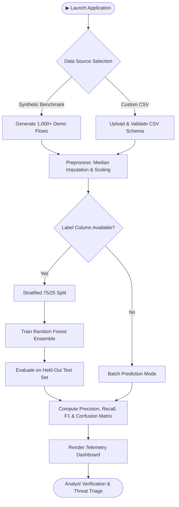

# CYBER GUARDIAN AI
### *AI-Powered Cyber Attacks and Defence*
**Tagline:** Detect Threats. Understand Attacks. Strengthen Defence.  
*Challenges, Detection, and Future Solutions*

[](https://www.python.org/)
[](https://opensource.org/licenses/MIT)
[](https://streamlit.io/)
[](https://scikit-learn.org/)
[]()

---

## Academic Context & Attribution

- **Project Name:** Cyber Guardian AI
- **Main Topic:** AI-Powered Cyber Attacks and Defence
- **Subtitle:** Challenges, Detection, and Future Solutions
- **Tagline:** Detect Threats. Understand Attacks. Strengthen Defence.
- **Development Group:** Cyber Nexus
- **Department:** Department of Cyber Security
- **University:** Sanjivani University
- **Repository:** [RushikeshNirmal45/Seminar-Prototype](https://github.com/RushikeshNirmal45/Seminar-Prototype)
- **Target Audience:** Seminar Evaluation Committee, Academic Viva, Cybersecurity Researchers, Student Portfolio

> ⚠️ **Academic Prototype Notice**: The default demonstration dataset is programmatically generated synthetic network-traffic data designed to demonstrate machine learning pipeline mechanics. All evaluation metrics displayed in the application are computed dynamically from actual held-out test records. High accuracy on synthetic data does not represent production enterprise intrusion prevention efficacy without field validation on real-world packet traces (e.g., CIC-IDS2017).

---

## Project Overview

**Cyber Guardian AI** is an interactive, academic cybersecurity web platform that analyzes network-traffic records, classifies connection flows across multiple threat categories, calculates empirical multiclass evaluation metrics, and presents clear security insights through a clean, modern, teacher-friendly blue and white dashboard.

Developed by **Cyber Nexus** at **Sanjivani University**, this project demonstrates how machine learning empowers cybersecurity education and defensive analysis by identifying anomalies and mitigating cyber attacks, while reinforcing why human verification and layered defence remain essential.

---

## Application Modules & Architecture

The application is structured into 8 clean, elegant, and teacher-friendly academic modules:

1. **Home**: Welcoming introduction, project explanation, key metric cards (Total Records, Model Accuracy, Macro F1-Score, Supported Categories), dataset loading controls, and overview charts.
2. **AI Threat Detection**: Intuitive threat classification module allowing users to upload CSV records or test with demo data, view predictions, inspect model confidence scores, and download full results.
3. **Network Traffic Analysis**: Exploratory interface with non-destructive filtering (protocol, duration, connection count), feature distributions, and an automated rule-based anomaly detector.
4. **Dataset Explorer**: In-depth dataset inspection tool with record preview, column schema audit, missing value checks, class balance metrics, and Pearson correlation heatmap.
5. **Threat Information**: Comprehensive educational breakdown of the 5 supported traffic categories (`BENIGN`, `DoS`, `DDoS`, `PortScan`, `BruteForce`), detailing what each threat means, how it works, its impact, and prevention methods.
6. **Model Performance**: Scientific evaluation dashboard featuring multiclass confusion matrices, classification report table, False Positive / False Negative analysis, and Random Forest feature importance rankings.
7. **Security Recommendations**: Practical, actionable cybersecurity best practices (strong passwords, MFA, firewalls, software updates, and incident response).
8. **About Project**: Complete academic documentation, problem statement, research objectives, system architecture, technology stack, limitations, and future scope.

---

## Problem Statement

Traditional network security controls primarily rely on signature-based Intrusion Detection Systems (IDS) and rigid rule engines. These approaches exhibit significant operational limitations:

1. **High False-Positive Volumes**: Benign statistical spikes trigger excessive low-priority alarms, causing severe analyst alert fatigue.
2. **Vulnerability to Dynamic Evasion**: Attackers leverage automated fuzzing, session fragmenting, and polymorphic payloads to bypass static hashes.
3. **Asymmetric Reaction Time**: Human analysts require hours to correlate disparate log lines, whereas automated exploits execute in seconds.
4. **Over-Promised Automation**: Deploying uncalibrated probabilistic models without human oversight creates costly disruption to legitimate business traffic.

---

## Project Motivation

Modern cyber defense requires intelligent systems capable of inspecting high-throughput telemetry at wire speed. By applying machine learning classification to statistical flow records, security teams can rapidly surface anomalous flows, prioritize high-risk connections, and identify subtle multi-vector attacks.

At the same time, this project demystifies AI in cybersecurity: it demonstrates how machine learning models actually evaluate features, where classification errors originate, and why human expertise must remain the ultimate authority in defensive operations.

---

## Research & Project Objectives

- **Modular Pipeline**: Construct an end-to-end pipeline covering ingestion, validation, preprocessing, ensemble learning, and post-prediction triage.
- **Multi-Vector Discrimination**: Classify connection flows across multiple categories: `BENIGN`, `DoS`, `DDoS`, `PortScan`, and `BruteForce`.
- **Honest Evaluation**: Compute and display authentic performance metrics directly from held-out test splits (no hardcoded scores or fabricated benchmark claims).
- **Interpretability**: Extract and visualize global feature importances to reveal the decision logic of the classifier.
- **Analyst-Centric UX**: Deliver a modern, clean blue and white academic Streamlit interface featuring risk indicators, interactive confusion matrices, full-width navigation, and intuitive dashboards.

---

## Proposed Solution: Cyber Guardian AI

The **Cyber Guardian AI** architecture operates on a 7-stage data and intelligence pipeline:

$$\text{Data Ingestion} \longrightarrow \text{Validation \& Cleaning} \longrightarrow \text{Feature Transformation} \longrightarrow \text{ML Classification} \longrightarrow \text{Risk Assessment} \longrightarrow \text{Analyst Review} \longrightarrow \text{Feedback Loop}$$

1. **Data Ingestion & Validation**: Rejects malformed records and validates 20 standard flow features.
2. **Preprocessing**: Scales numeric columns via `StandardScaler`, one-hot encodes protocol categories, and handles missing/infinite values safely.
3. **Model Training**: Employs a 150-tree Random Forest classifier with `class_weight='balanced'` and stratified 75/25 train-test splitting.
4. **Empirical Evaluation**: Validates predictions on unseen held-out records, deriving accuracy, precision, recall, F1, and full confusion matrices.
5. **Operational Risk Mapping**: Translates tree ensemble vote distributions into model confidence scores and two-tier operational risk flags (`LOW` vs. `HIGH`). (Note: tree vote proportions are uncalibrated and reflect ensemble agreement rather than true posterior attack probabilities).

---

## Key Features

- 🛡️ **Interactive Multi-View Dashboard**: 8 dedicated workspaces tailored for threat analysts.
- 🔬 **Built-in Synthetic Data Generator**: Instant generation of reproducible 1,000+ record flow benchmarks.
- 📂 **Custom CSV Ingestion**: Support for uploading custom datasets with automated schema compliance checks.
- 🤖 **Random Forest Classifier**: Scikit-learn ensemble optimized for multi-class flow discrimination.
- 🎯 **Authentic Metric Computation**: Dynamic calculation of Accuracy, Macro Precision, Macro Recall, and Macro/Weighted F1.
- 🔍 **Interactive Confusion Matrix**: Heatmap visualization showing exact counts and true-class percentages.
- 📊 **False Positive / Negative Breakdown**: Dedicated per-class tabular accounting of Type I and Type II errors.
- 💡 **Automated Security Insights**: Rule-guided textual observations generated dynamically from model output distributions.
- 📚 **Threat Intelligence Library**: Educational coverage of emerging AI-assisted threats (phishing, deepfakes, malware, prompt injection).

---

## System Architecture

```mermaid
flowchart TD
    subgraph S1["1. Data Input Layer"]
        A["User / Security Analyst"] --> UI["Streamlit Web Interface"]
        UI --> DS1["Synthetic Dataset Generator (1,000+ Flows)"]
        UI --> DS2["Custom Batch CSV Upload (Max 200MB)"]
    end

    subgraph S2["2. Data Preprocessing & Validation"]
        DS1 --> PRE["Data Sanitization & Type Coercion"]
        DS2 --> PRE
        PRE --> VAL{"Schema & Feature Validation"}
        VAL -->|❌ Invalid Schema| ERR["Explicit Error & Guidance"]
        ERR --> UI
        VAL -->|✅ Valid Schema| COL["ColumnTransformer (StandardScaler + OneHotEncoder)"]
    end

    subgraph S3["3. Machine Learning Classification"]
        COL --> SPLIT{"Has Labels for Training?"}
        SPLIT -->|Yes| TRAIN["Stratified Split (75% Train / 25% Test)"]
        TRAIN --> RF["Random Forest Classifier (150 Trees, Balanced Weights)"]
        RF --> EVAL["Held-Out Empirical Test Evaluation"]
        SPLIT -->|No (Batch Ingestion)| PRED["Batch Prediction Engine"]
        RF --> PRED
        PRED --> VOTE["Tree Ensemble Consensus & Risk Scoring"]
    end

    subgraph S4["4. Threat Classification Output"]
        VOTE --> C1["BENIGN (Normal Connection Traffic)"]
        VOTE --> C2["DoS (Denial of Service)"]
        VOTE --> C3["DDoS (Distributed Denial of Service)"]
        VOTE --> C4["PortScan (Network Reconnaissance)"]
        VOTE --> C5["BruteForce (Credential Attacks)"]
    end

    subgraph S5["5. Risk Information & Visualisation"]
        EVAL --> DASH1["Model Evaluation Dashboard (Acc, F1, Confusion Matrix, FP/FN)"]
        C1 & C2 & C3 & C4 & C5 --> DASH2["Interactive Telemetry & Anomaly Dashboard"]
        C1 & C2 & C3 & C4 & C5 --> DASH3["Threat Distribution & Flow Inspection"]
        DASH1 & DASH2 & DASH3 --> UI
    end

    subgraph S6["6. Defensive Recommendations (Implemented Advisory)"]
        DASH2 --> REC["Security Recommendations & Response Playbooks"]
        REC --> REV["Human-in-the-Loop Analyst Triage (Advisory Support)"]
    end

    subgraph S7["7. Proposed Extensions & Future Scope"]
        REV -.->|Proposed Extension| EXP["Forensic Incident Report Export"]
        REV -.->|Future Scope (Conceptual)| SNIFF["Live Packet Sniffing (eBPF / pyshark)"]
        REV -.->|Future Scope (Conceptual)| BLK["Autonomous Firewall Blocking / Isolation"]
    end
```

---

## Operational Workflow



---

## Technology Stack

| Layer | Technology | Version | Purpose |
|---|---|---|---|
| **Runtime** | Python | 3.12.10 | Core execution environment |
| **User Interface** | Streamlit | 1.40.0 | High-performance reactive web dashboard |
| **Machine Learning** | Scikit-Learn | 1.5.2 | Preprocessing pipelines, ensemble classifiers, metrics |
| **Data Manipulation** | Pandas | 2.2.3 | Tabular dataset management and aggregation |
| **Numerical Computing** | NumPy | 2.5.4 | Vectorized operations and random distributions |
| **Visualizations** | Plotly | 5.24.1 | Interactive telemetry and confusion matrix charts |
| **Static Plotting** | Matplotlib | 3.9.2 | Complementary statistical plotting |
| **Automated Testing** | Pytest | 8.3.3 | Regression and unit validation suite |

---

## Repository Structure

```
Seminar-Prototype/
├── app.py                      # Main Streamlit dashboard application
├── requirements.txt            # Pinned, reproducible project dependencies
├── README.md                   # Comprehensive repository documentation
├── LICENSE                     # MIT Open Source License
├── .gitignore                  # Git exclusion rules (caches, models, data)
├── .streamlit/
│   └── config.toml             # Streamlit modern light blue and white academic theme configuration
├── src/
│   ├── __init__.py             # Package marker
│   ├── data_processing.py      # Validation, sanitization, synthetic generation
│   ├── model.py                # Scikit-learn Pipeline and Random Forest classifier
│   ├── detection.py            # Workflow orchestration and risk categorization
│   ├── evaluation.py           # Metric calculation and false-positive/negative analysis
│   └── visualizations.py       # Interactive Plotly and Matplotlib charting routines
├── data/
│   └── README.md               # Dataset documentation and expected CSV schema
├── tests/
│   ├── conftest.py                 # Pytest fixtures and synthetic testing data
│   ├── test_data_processing.py     # Ingestion, validation, and cleaning tests
│   ├── test_model.py               # ML pipeline, reproducibility, and prediction tests
│   ├── test_detection.py           # Workflow orchestration and risk scoring tests
│   ├── test_evaluation.py          # Metric computation and boundary condition tests
│   └── test_analyzer_and_triage.py # Traffic analysis, triage explanations, and visualizations
├── docs/
│   ├── introduction.md         # Research context and AI dual-use landscape
│   ├── problem-statement.md    # Analysis of modern network threat detection challenges
│   ├── objectives.md           # Engineering and research goals
│   ├── proposed-solution.md    # Detailed framework architecture
│   ├── methodology.md          # 7-phase research process
│   ├── architecture.md         # Technical component specifications
│   ├── threat-model.md         # STRIDE threat assessment and risk matrix
│   ├── testing.md              # Test execution summary and coverage details
│   ├── limitations.md          # Engineering constraints and academic disclosures
│   ├── future-scope.md         # Technical roadmap and planned enhancements
│   ├── references.md           # Peer-reviewed academic citations
│   ├── demonstration-guide.md  # Script for live demonstration
│   └── viva-questions.md       # 23 Viva questions with technical answers
├── diagrams/
│   ├── architecture.mmd        # Mermaid source for architecture diagram
│   └── workflow.mmd            # Mermaid source for operational workflow
└── screenshots/
    └── README.md               # Guidance for capturing and storing interface screenshots
```

---

## Installation & Setup

### Prerequisites
- Python 3.11 or 3.12 installed on your system.
- Git configured locally.

### Step-by-Step Installation

1. **Clone the Repository**:
   ```bash
   git clone https://github.com/RushikeshNirmal45/Seminar-Prototype.git
   cd Seminar-Prototype
   ```

2. **Create and Activate a Virtual Environment** (Recommended):
   ```bash
   # Windows PowerShell
   python -m venv venv
   .\venv\Scripts\Activate.ps1
   ```

3. **Install Dependencies**:
   ```bash
   pip install -r requirements.txt
   ```

---

## Running the Application

Launch the Streamlit web dashboard:
```bash
streamlit run app.py
```

The application will start locally and open in your default browser at `http://localhost:8501`.

---

## How to Use the Application

### 1. Using Demonstration Data (Recommended for Quick Evaluation)
1. In the sidebar, click on **Home** or **AI Threat Detection**.
2. Click **"🚀 Load Demo Dataset & Train Baseline"** (if not already trained) or **"⚡ Test 100-Flow Batch"**.
3. Navigate to **AI Threat Detection** and click **"⚡ Execute Machine Learning Analysis"**.
4. The pipeline performs an automated stratified split, fits 150 decision trees, and computes real metrics on the held-out test split.
5. Review the resulting classification report, confusion matrix, and feature importances under **Model Performance** and telemetry insights under **Network Traffic Analysis**.

### 2. Uploading a Custom CSV Dataset
1. Prepare a CSV file containing connection flow features (refer to [data/README.md](data/README.md) or download the template).
2. Go to **AI Threat Detection**.
3. Upload the file using the file uploader widget (or click **"⬇ CSV Template"** to inspect the required format).
4. The system validates the schema against required columns before execution.
5. Click **"⚡ Execute Machine Learning Analysis"** to evaluate predictions, inspect model confidence scores, and review defensive recommendations.

---

## Explanation of Evaluation Metrics

All metrics in Cyber Guardian AI are calculated empirically against held-out test records:

- **Multiclass Accuracy**: $\frac{\sum_{k=1}^K C_{kk}}{N} = \frac{\sum_{k=1}^K TP_k}{N}$ — Proportion of all evaluated records correctly classified (sum of confusion matrix diagonal elements $C_{kk}$ divided by total sample size $N$).
- **Precision (Macro)**: $\frac{1}{K}\sum_{k=1}^K \frac{TP_k}{TP_k + FP_k}$ — Unweighted arithmetic average of precision across all $K$ classes. Measures the reliability of positive attack predictions.
- **Recall (Macro)**: $\frac{1}{K}\sum_{k=1}^K \frac{TP_k}{TP_k + FN_k}$ — Unweighted arithmetic average of recall across all $K$ classes. Measures the fraction of actual threats caught.
- **F1-Score (Macro)**: $\frac{1}{K}\sum_{k=1}^K \frac{2 \cdot \text{Precision}_k \cdot \text{Recall}_k}{\text{Precision}_k + \text{Recall}_k}$ — Unweighted arithmetic mean of individual class F1-scores. Treats minority and majority classes equally.
- **Confusion Matrix**: $K \times K$ contingency table contrasting ground truth labels (rows) against predicted labels (columns).
- **Per-Class False Positive (FP)**: Non-target or benign traffic erroneously flagged as attack class $k$ (induces alert fatigue).
- **Per-Class False Negative (FN)**: True attack class $k$ traffic misclassified as benign or another class (permits undetected intrusions).

---

## Test Execution & Verification

The project includes an automated test suite implemented in `pytest`:

```bash
python -m pytest tests/ -v --tb=short
```

**Actual Verified Outcome**:
```
======================== 84 passed, 15 warnings in ~11.0s ========================
```

*(Note: The single `UserWarning` in `test_single_class_warning` is triggered intentionally to verify safe edge-case handling by the evaluation engine; deprecation warnings from matplotlib's internal parsing do not affect runtime stability).*

The 84 tests rigorously validate:
- Synthetic generation schema compliance and non-null guarantees.
- Ingestion bounds, malformed CSV error handling, and whitespace cleaning.
- Dataframe preprocessing, missing value imputation, and all-NaN / infinity replacements.
- Scikit-learn pipeline integrity, stratified split consistency, and prediction shape.
- Confusion matrix computations, multi-class metrics, and per-class FP/FN calculations.
- Rule-based traffic anomaly detector and Pearson feature correlation matrix calculation.
- Threat categorization, dynamic flow explanations, and SOC defensive playbook assignments.
- Interactive Plotly telemetry charts, protocol breakdowns, and volume dispersion plots.

---

## Limitations & Responsible Use

1. **Synthetic Data**: The built-in benchmark dataset is synthetically generated. Model metrics obtained on synthetic data do not represent real-world network detection efficacy.
2. **Concept Drift**: Attack patterns evolve rapidly. Real-world deployments require regular retraining on fresh traffic telemetry.
3. **No Autonomous Enforcement**: Cyber Guardian AI is an analyst decision-support system. It must not be configured to autonomously drop or block network traffic without human verification.
4. **Encrypted Payloads**: As a flow-based classifier, the model analyzes metadata (timing, byte volume, frequency) rather than encrypted packet payloads.

---

## Future Enhancements

- 🧠 **Explainable AI (XAI)**: Integration of SHAP and LIME for per-connection local feature attributions.
- 📡 **Live Packet Ingestion**: Real-time packet capture via `pyshark` and live flow aggregation.
- ⏳ **Sequential Deep Learning**: Bidirectional LSTM / Transformer models for temporal session tracking.
- 🔄 **Zero Trust & SOAR Connectors**: Authenticated webhooks for automated SIEM alert escalation.

---

## References

1. Breiman, L. (2001). *Random Forests.* Machine Learning, 45(1), 5-32.
2. Tavallaee, M., Bagheri, E., Lu, W., & Ghorbani, A. A. (2009). *A Detailed Analysis of the KDD CUP 99 Data Set.* IEEE CISDA.
3. Sharafaldin, I., Lashkari, A. H., & Ghorbani, A. A. (2018). *Toward Generating a New Intrusion Detection Dataset (CIC-IDS2017).* ICISSP.
4. Sommer, R., & Paxson, V. (2010). *Outside the Closed World: On Using Machine Learning for Network Intrusion Detection.* IEEE S&P.
5. Pedregosa, F., et al. (2011). *Scikit-learn: Machine Learning in Python.* JMLR.

---

## License

This project is licensed under the MIT License — see the [LICENSE](LICENSE) file for details.

